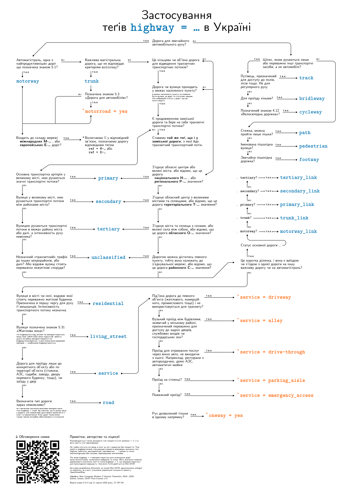

# Схема застосування теґів `highway = …` в Україні

Блок-схема, що спрощує вибір значення теґу `highway=*` для позначення доріг в Україні
відповідно до [домовленості української спільноти OpenStreetMap](https://wiki.openstreetmap.org/wiki/Uk:Вікіпроект_Україна/Класифікація_доріг).

## Обговорення

Схему обговорюють на форумі української спільноти OpenStreetMap. Роботу над нею
почали 2013 року в темі [Автомобільні шляхи України](https://community.openstreetmap.org/t/topic/50063/196),
а оновлення до версії 2.0.11 обговорювали 2025 року в темі
[Оновлення схеми застосування теґів `highway`](https://community.openstreetmap.org/t/topic/133408).
Пропозиції та зауваження можна лишати як там, так і в
[issues](https://github.com/Andygol/osm-highway-tag/issues) цього репозиторію.

## Автори

Схему розроблено dimonster на основі Вікі-OSM, вдосконалено andygol та darkonus,
за участі учасників української спільноти проєкту OpenStreetMap.

Шрифти: New Computer Modern © Antonis Tsolomitis, 2019—2025, Samos, Greece,
[GUST Font License v1.0](https://www.gust.org.pl/projects/e-foundry/licenses).
