# Застосування теґів `highway = …` в Україні

```mermaid
flowchart TD

hw(["<code>highway = …</code>"]) --> q_car{"`Дорога для звичайного автомобільного руху?`"}

%% ─────────── Автомагістралі та магістральні дороги ───────────

q_car -- так --> q_mw{"`Автомагістраль, одна з найпродуктивніших доріг, що позначена знаком **5.1**?`"}
q_mw -- так --> mw(["<code>motorway</code>"])
q_mw -- ні --> q_tr{"`Важлива магістральна дорога, що не відповідає критеріям <code>motorway</code>?`"}
q_tr -- так --> tr(["<code>trunk</code>"])
q_tr -- ні --> q_ring
tr --> q_motorroad{"`Позначена знаком **5.3** «Дорога для автомобілів»?`"}
q_motorroad -- так --> motorroad(["+ <code>motorroad = yes</code>"])

mw --> q_intl
motorroad --> q_intl
q_motorroad -- ні --> q_intl
q_intl{"`Входить до складу мережі міжнародних **М-…** або європейських **Е-…** доріг?`"}
q_intl -- так --> intl(["`Включаємо її у відповідний звʼязок, позначаємо дорогу відповідним теґом <code>ref = M-…</code> або <code>ref = E-…</code>`"])

%% ─────────── Кільцеві дороги та межі населеного пункту ───────────

q_ring{"`Це кільцева чи обʼїзна дорога для відведення транзитних транспортних потоків?`"}
q_ring -- так --> q_np
q_ring -- ні --> q_p_out
q_np{"`Дорога чи вулиця проходить у межах населеного пункту?`"}
q_np -- ні --> q_p_out
q_np -- так --> q_cont
q_cont{"`Є продовженням заміської дороги та бере на себе транзитні транспортні потоки?`"}
q_cont -- так --> same(["`Ставимо **той же теґ, що і у заміської дороги**, з якої йде транзитний транспортний потік`"])
q_cont -- ні --> q_p_in

%% ─────────── Класифікація за важливістю ───────────

subgraph city ["Дороги в межах населеного пункту"]
  q_p_in{"`Основна транспортна артерія у великому місті, нею рухаються значні транспортні потоки?`"}
  q_s_in{"`Вулиця у великому місті, нею рухаються транспортні потоки між районами міста?`"}
  q_t_in{"`Вулицею рухаються транспортні потоки в межах району міста або далі, а інтенсивність руху невелика?`"}
  q_u_in{"`Незначний «транзитний» трафік до інших мікрорайонів, або далі? Або вздовж вулиці стоять переважно нежитлові споруди?`"}
  q_p_in -- ні --> q_s_in
  q_s_in -- ні --> q_t_in
  q_t_in -- ні --> q_u_in
end

subgraph rural ["Дороги поза межами населеного пункту"]
  q_p_out{"`Зʼєднує обласні центри або великі міста, або відомо, що це дорога **національного Н-…** або **регіонального Р-…** значення?`"}
  q_s_out{"`Зʼєднує обласний центр з великими містами та селищами, або відомо, що це дорога **територіального Т-…** значення?`"}
  q_t_out{"`Зʼєднує міста та селища з селами, або великі села між собою, або відомо, що це дорога **обласного О-…** значення?`"}
  q_u_out{"`Дорогою можна дістатись певного пункту, тобто вона належить до зʼєднувальної мережі, або відомо, що це дорога **районного С-…** значення?`"}
  q_p_out -- ні --> q_s_out
  q_s_out -- ні --> q_t_out
  q_t_out -- ні --> q_u_out
end

q_p_in -- так --> primary(["<code>primary</code>"])
q_p_out -- так --> primary
q_s_in -- так --> secondary(["<code>secondary</code>"])
q_s_out -- так --> secondary
q_t_in -- так --> tertiary(["<code>tertiary</code>"])
q_t_out -- так --> tertiary
q_u_in -- так --> unclassified(["<code>unclassified</code>"])
q_u_out -- так --> unclassified

q_u_in -- ні --> q_res
q_u_out -- ні --> q_link

%% ─────────── Зʼєднувальні дороги ───────────

q_link{"`Це коротка ділянка, і вона є виїздом чи зʼїздом з однієї дороги на іншу важливу дорогу чи на автомагістраль?`"}
q_link -- ні --> q_res
q_link -- так --> l_status

subgraph links ["Типи зʼєднувальних доріг"]
  l_status{"`Статус основної дороги …`"}
  l_status --> l_mw{"<code>motorway</code>?"}
  l_mw -- так --> mwl(["<code>motorway_link</code>"])
  l_mw -- ні --> l_tr{"<code>trunk</code>?"}
  l_tr -- так --> trl(["<code>trunk_link</code>"])
  l_tr -- ні --> l_p{"<code>primary</code>?"}
  l_p -- так --> pl(["<code>primary_link</code>"])
  l_p -- ні --> l_s{"<code>secondary</code>?"}
  l_s -- так --> sl(["<code>secondary_link</code>"])
  l_s -- ні --> l_t{"<code>tertiary</code>?"}
  l_t -- так --> tl(["<code>tertiary_link</code>"])
end

%% ─────────── Вулиці, службові проїзди, невизначені дороги ───────────

q_res{"`Вулиця в місті чи селі, вздовж якої стоять переважно житлові будинки. Призначена в першу чергу для руху її мешканців. Інтенсивність транспортного потоку незначна`"}
q_res -- так --> residential(["<code>residential</code>"])
q_res -- ні --> q_ls
q_ls{"`Вулиця позначена знаком **5.31** «Житлова зона»?`"}
q_ls -- так --> living(["<code>living_street</code>"])
q_ls -- ні --> q_srv
q_srv{"`Дорога для проїзду лише до конкретного обʼєкту або по території обʼєкта (стоянки, АЗС, садиби, заводу, двору окремого будинку, тощо), чи заїзду у двір`"}
q_srv -- так --> service(["<code>service</code>"])
q_srv -- ні --> q_road
q_road{"`Визначити тип дороги зараз неможливо?`"}
q_road -- так --> road(["<code>road</code>"])

service --> q_driveway
subgraph srv ["Службові проїзди"]
  q_driveway{"`Підʼїзна дорога до певного обʼєкта (житлового, комерційного, промислового тощо) і не використовується для транзиту?`"}
  q_driveway -- так --> driveway(["+ <code>service = driveway</code>"])
  q_driveway -- ні --> q_alley
  q_alley{"`Вузький проїзд між будівлями, зазвичай у міському районі, призначений переважно для доступу до задніх дворів, службових входів чи господарських зон?`"}
  q_alley -- так --> alley(["+ <code>service = alley</code>"])
  q_alley -- ні --> q_dt
  q_dt{"`Проїзд для отримання послуг через вікно авто, не виходячи з нього. Наприклад: ресторани з автороздачею, деякі АЗС, автоматичні мийки`"}
  q_dt -- так --> dt(["+ <code>service = drive-through</code>"])
  q_dt -- ні --> q_pa
  q_pa{"`Проїзд на стоянці?`"}
  q_pa -- так --> pa(["+ <code>service = parking_aisle</code>"])
  q_pa -- ні --> q_ea
  q_ea{"`Пожежний проїзд?`"}
  q_ea -- так --> ea(["+ <code>service = emergency_access</code>"])
end

%% ─────────── Інші види руху ───────────

q_car -- ні --> q_other
subgraph other ["Інші види руху"]
  q_other{"`Шлях, яким рухаються лише або переважно інші транспортні засоби, а не автомобілі?`"}
  q_other -- так --> q_track
  q_track{"`Путівець, призначений для доступу до полів, лісів тощо. Не для регулярного руху`"}
  q_track -- так --> track(["<code>track</code>"])
  q_track -- ні --> q_bridle
  q_bridle{"`Для проїзду кіньми?`"}
  q_bridle -- так --> bridleway(["<code>bridleway</code>"])
  q_bridle -- ні --> q_cycle
  q_cycle{"`Позначений знаком **4.12** «Велосипедна доріжка»?`"}
  q_cycle -- так --> cycleway(["<code>cycleway</code>"])

  q_other -- ні --> q_path
  q_path{"`Стежка, можна пройти лише пішки?`"}
  q_path -- так --> path(["<code>path</code>"])
  q_path -- ні --> q_ped
  q_ped{"`Іменована пішохідна вулиця?`"}
  q_ped -- так --> pedestrian(["<code>pedestrian</code>"])
  q_ped -- ні --> q_foot
  q_foot{"`Звичайна пішохідна доріжка?`"}
  q_foot -- так --> footway(["<code>footway</code>"])
end

%% ─────────── Напрямок руху ───────────

q_oneway{"`Рух дозволений тільки в одному напрямку?`"} -- так --> oneway(["+ <code>oneway = yes</code>"])

%% ─────────── Примітки ───────────

n_surface@{ shape: braces, label: 'Рекомендується також вказувати тип покриття (теґ <code>surface=\*</code>) та його якість (теґ <code>smoothness=\*</code>)' }
hw -.- n_surface

n_area@{ shape: braces, label: 'Теґ <code>area:highway=\*</code> використовується для позначення доріг мультиполігонами, позначення майданів та площ. Його значення повинне дорівнювати значенню лінії із теґом <code>highway=\*</code>, що використовується для прокладання маршруту' }
hw -.- n_area

n_np@{ shape: braces, label: "У межах населеного пункту не повинно бути вулиць чи доріг зі статусом, вищим ніж найвищий статус у доріг, що до нього ведуть" }
q_np -.- n_np

n_ls@{ shape: braces, label: "Теґ <code>highway=living_street</code> не використовується, якщо знак «Житлова зона» відсутній, замість цього потрібно використовувати теґ <code>highway=residential</code>, а для позначення дворових проїздів — комбінацію з <code>highway=service</code>" }
q_ls -.- n_ls

n_road@{ shape: braces, label: "Як <b>тимчасове</b> значення можливе використання теґу <code>highway=road</code>. Це означає, що в цьому місці є дорога, але неможливо достовірно визначити її клас та призначення. Клас доріг позначених таким чином потребує обовʼязкового уточнення!" }
q_road -.- n_road

n_track@{ shape: braces, label: "Не треба плутати путівець в полі чи лісі з дорогою без покриття. Тож замість <code>highway=track</code> слід використовувати відповідне значення теґу <code>highway</code> (<code>service</code>, <code>unclassified</code>, <code>residential</code>, …) разом із теґом <code>surface=ground</code> або іншими, відповідними значеннями" }
track -.- n_track
```

---

Схему розроблено dimonster на основі Вікі-OSM, вдосконалено andygol та darkonus,
за участі учасників української спільноти проєкту OpenStreetMap.
Версія схеми 2.0.11 від 11 серпня 2025 року, CC BY-SA.
