# Схема застосування теґів `highway = …` в Україні

Текстовий варіант [схеми](README.md) версії 2.0.11 від 11 серпня 2025 року.
Він повторює логіку графічної схеми, але доступний для пошуку та копіювання.

```mermaid
flowchart TD

hw(["highway = …"]) --> q_car{"Дорога для звичайного<br>автомобільного руху?"}

%% ─────────── Автомагістралі та магістральні дороги ───────────

q_car -- так --> q_mw{"Автомагістраль, одна з найпродуктивніших<br>доріг, що позначена знаком 5.1?"}
q_mw -- так --> mw(["motorway"])
q_mw -- ні --> q_tr{"Важлива магістральна дорога, що<br>не відповідає критеріям motorway?"}
q_tr -- так --> tr(["trunk"])
q_tr -- ні --> q_ring
tr --> q_motorroad{"Позначена знаком 5.3<br>«Дорога для автомобілів»?"}
q_motorroad -- так --> motorroad(["+ motorroad = yes"])

mw --> q_intl
motorroad --> q_intl
q_motorroad -- ні --> q_intl
q_intl{"Входить до складу мережі міжнародних М-…<br>або європейських Е-… доріг?"}
q_intl -- так --> intl(["+ Включаємо її у відповідний звʼязок,<br>позначаємо дорогу відповідним теґом<br>ref = M-… або ref = E-…"])

%% ─────────── Кільцеві дороги та межі населеного пункту ───────────

q_ring{"Це кільцева чи обʼїзна дорога для відведення<br>транзитних транспортних потоків?"}
q_ring -- так --> q_np
q_ring -- ні --> q_p_out
q_np{"Дорога чи вулиця проходить<br>у межах населеного пункту? ¹"}
q_np -- ні --> q_p_out
q_np -- так --> q_cont
q_cont{"Є продовженням заміської дороги та бере<br>на себе транзитні транспортні потоки?"}
q_cont -- так --> same(["Ставимо той же теґ, що і у заміської дороги,<br>з якої йде транзитний транспортний потік"])
q_cont -- ні --> q_p_in

%% ─────────── Класифікація за важливістю ───────────

subgraph city ["Дороги в межах населеного пункту"]
  q_p_in{"Основна транспортна артерія у великому місті,<br>нею рухаються значні транспортні потоки?"}
  q_s_in{"Вулиця у великому місті, нею рухаються<br>транспортні потоки між районами міста?"}
  q_t_in{"Вулицею рухаються транспортні потоки в межах району<br>міста або далі, а інтенсивність руху невелика?"}
  q_u_in{"Незначний «транзитний» трафік до інших мікрорайонів,<br>або далі? Або вздовж вулиці стоять переважно<br>нежитлові споруди?"}
  q_p_in -- ні --> q_s_in
  q_s_in -- ні --> q_t_in
  q_t_in -- ні --> q_u_in
end

subgraph rural ["Дороги поза межами населеного пункту"]
  q_p_out{"Зʼєднує обласні центри або великі міста, або відомо, що це<br>дорога національного Н-… або регіонального Р-… значення?"}
  q_s_out{"Зʼєднує обласний центр з великими містами та селищами,<br>або відомо, що це дорога територіального Т-… значення?"}
  q_t_out{"Зʼєднує міста та селища з селами, або великі села між собою,<br>або відомо, що це дорога обласного О-… значення?"}
  q_u_out{"Дорогою можна дістатись певного пункту, тобто вона належить<br>до зʼєднувальної мережі, або відомо, що це дорога<br>районного С-… значення?"}
  q_p_out -- ні --> q_s_out
  q_s_out -- ні --> q_t_out
  q_t_out -- ні --> q_u_out
end

q_p_in -- так --> primary(["primary"])
q_p_out -- так --> primary
q_s_in -- так --> secondary(["secondary"])
q_s_out -- так --> secondary
q_t_in -- так --> tertiary(["tertiary"])
q_t_out -- так --> tertiary
q_u_in -- так --> unclassified(["unclassified"])
q_u_out -- так --> unclassified

q_u_in -- ні --> q_res
q_u_out -- ні --> q_link

%% ─────────── Зʼєднувальні дороги ───────────

q_link{"Це коротка ділянка, і вона є виїздом чи зʼїздом з однієї<br>дороги на іншу важливу дорогу чи на автомагістраль?"}
q_link -- ні --> q_res
q_link -- так --> l_status

subgraph links ["Типи зʼєднувальних доріг"]
  l_status{"Статус основної дороги …"}
  l_status --> l_mw{"motorway?"}
  l_mw -- так --> mwl(["motorway_link"])
  l_mw -- ні --> l_tr{"trunk?"}
  l_tr -- так --> trl(["trunk_link"])
  l_tr -- ні --> l_p{"primary?"}
  l_p -- так --> pl(["primary_link"])
  l_p -- ні --> l_s{"secondary?"}
  l_s -- так --> sl(["secondary_link"])
  l_s -- ні --> l_t{"tertiary?"}
  l_t -- так --> tl(["tertiary_link"])
end

%% ─────────── Вулиці, службові проїзди, невизначені дороги ───────────

q_res{"Вулиця в місті чи селі, вздовж якої стоять переважно житлові<br>будинки. Призначена в першу чергу для руху її мешканців.<br>Інтенсивність транспортного потоку незначна"}
q_res -- так --> residential(["residential"])
q_res -- ні --> q_ls
q_ls{"Вулиця позначена знаком 5.31<br>«Житлова зона»? ²"}
q_ls -- так --> living(["living_street"])
q_ls -- ні --> q_srv
q_srv{"Дорога для проїзду лише до конкретного обʼєкту або по території<br>обʼєкта (стоянки, АЗС, садиби, заводу, двору окремого будинку,<br>тощо), чи заїзду у двір"}
q_srv -- так --> service(["service"])
q_srv -- ні --> q_road
q_road{"Визначити тип дороги зараз неможливо? ³"}
q_road -- так --> road(["road"])

service --> q_driveway
subgraph srv ["Службові проїзди"]
  q_driveway{"Підʼїзна дорога до певного обʼєкта (житлового,<br>комерційного, промислового тощо) і не<br>використовується для транзиту?"}
  q_driveway -- так --> driveway(["+ service = driveway"])
  q_driveway -- ні --> q_alley
  q_alley{"Вузький проїзд між будівлями, зазвичай у міському районі,<br>призначений переважно для доступу до задніх дворів,<br>службових входів чи господарських зон?"}
  q_alley -- так --> alley(["+ service = alley"])
  q_alley -- ні --> q_dt
  q_dt{"Проїзд для отримання послуг через вікно авто, не виходячи<br>з нього. Наприклад: ресторани з автороздачею,<br>деякі АЗС, автоматичні мийки"}
  q_dt -- так --> dt(["+ service = drive-through"])
  q_dt -- ні --> q_pa
  q_pa{"Проїзд на стоянці?"}
  q_pa -- так --> pa(["+ service = parking_aisle"])
  q_pa -- ні --> q_ea
  q_ea{"Пожежний проїзд?"}
  q_ea -- так --> ea(["+ service = emergency_access"])
end

%% ─────────── Інші види руху ───────────

q_car -- ні --> q_other
subgraph other ["Інші види руху"]
  q_other{"Шлях, яким рухаються лише або переважно<br>інші транспортні засоби, а не автомобілі?"}
  q_other -- так --> q_track
  q_track{"Путівець, призначений для доступу<br>до полів, лісів тощо.<br>Не для регулярного руху"}
  q_track -- так --> track(["track"])
  q_track -- ні --> q_bridle
  q_bridle{"Для проїзду кіньми?"}
  q_bridle -- так --> bridleway(["bridleway"])
  q_bridle -- ні --> q_cycle
  q_cycle{"Позначений знаком 4.12<br>«Велосипедна доріжка»?"}
  q_cycle -- так --> cycleway(["cycleway"])

  q_other -- ні --> q_path
  q_path{"Стежка, можна пройти лише пішки?"}
  q_path -- так --> path(["path"])
  q_path -- ні --> q_ped
  q_ped{"Іменована пішохідна вулиця?"}
  q_ped -- так --> pedestrian(["pedestrian"])
  q_ped -- ні --> q_foot
  q_foot{"Звичайна пішохідна доріжка?"}
  q_foot -- так --> footway(["footway"])
end

%% ─────────── Напрямок руху ───────────

q_oneway{"Рух дозволений тільки<br>в одному напрямку?"} -- так --> oneway(["+ oneway = yes"])
```

---

¹ У межах населеного пункту не повинно бути вулиць чи доріг зі статусом, вищим
ніж найвищий статус у доріг, що до нього ведуть.

² Теґ `highway=living_street` не використовується, якщо знак «Житлова зона»
відсутній, замість цього потрібно використовувати теґ `highway=residential`,
а для позначення дворових проїздів — комбінацію з `highway=service`.

³ Як тимчасове значення можливе використання теґу `highway=road`. Це означає,
що в цьому місці є дорога, але неможливо достовірно визначити її клас та
призначення. Клас доріг позначених таким чином потребує обовʼязкового уточнення!

## Додаткові примітки

Рекомендується також вказувати тип покриття (теґ `surface=*`) та його якість
(теґ `smoothness=*`).

Не треба плутати путівець в полі чи лісі з дорогою без покриття. Тож замість
`highway=track` слід використовувати відповідне значення теґу `highway`
(`service`, `unclassified`, `residential`, …) разом із теґом `surface=ground`
або іншими, відповідними значеннями.

Теґ `area:highway=*` використовується для позначення доріг мультиполігонами,
позначення майданів та площ. Його значення повинне дорівнювати значенню лінії
із теґом `highway=*`, що використовується для прокладання маршруту. Значення
теґів дивіться на Вікі-OSM.

---

Схему розроблено dimonster на основі Вікі-OSM, вдосконалено andygol та darkonus,
за участі учасників української спільноти проєкту OpenStreetMap.
Версія схеми 2.0.11 від 11 серпня 2025 року, CC BY-SA.
